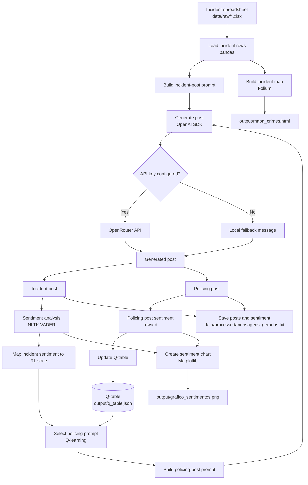

# Sentiment Analysis App

This project generates social media posts about vehicle theft incidents, analyzes their sentiment, updates a reinforcement learning Q-table, and creates an incident map and sentiment chart.

## Requirements

- Python.
- Dependencies: `pandas`, `openpyxl`, `folium`, `matplotlib`, `nltk`, and `openai`.
- An `OPENROUTER_API_KEY` or `OPENAI_API_KEY` environment variable to generate messages using the model configured for OpenRouter. Without an API key, the script uses local fallback messages.

Install the dependencies with:

```bash
python -m pip install -r requirements.txt
```

The script downloads the NLTK VADER lexicon on the first run, if needed.

## Input data

Place `VeiculosSubtraidos_2024.xlsx` in `data/raw/`. The script reads the `AMOSTRAGEM` worksheet and uses fields such as `BAIRRO`, `DATA_OCORRENCIA_BO`, `HORA_OCORRENCIA`, `DESCR_TIPO_VEICULO`, `LATITUDE`, and `LONGITUDE`.

## Architecture

The diagram below shows the main data flow. The OpenRouter API is optional; without an API key, the app generates posts using local fallback messages.



## Run

From the project root, run:

```bash
python rl_sentimental_app.py
```

Messages are generated in English. Sentiment is analyzed with VADER. The Q-table selects among three prompts for the policing post and is updated using that post's sentiment score.

## Docker

Build the image and run the app from the project root:

```bash
docker build -t sentiment-analysis .
docker run --rm -e OPENROUTER_API_KEY sentiment-analysis
```

The API key is optional; without it, the script uses local fallback messages. To retain generated files after the container exits, mount the output and processed-data directories:

```bash
docker run --rm -e OPENROUTER_API_KEY -v "${PWD}/output:/app/output" -v "${PWD}/data/processed:/app/data/processed" sentiment-analysis
```

## Generated files

- `data/processed/mensagens_geradas.txt`: generated posts and sentiment analysis results.
- `output/grafico_sentimentos.png`: sentiment score chart.
- `output/mapa_crimes.html`: interactive incident map.
- `output/q_table.json`: Q-table persisted between runs.

If `output/q_table.json` does not exist yet, the script attempts to load the legacy `q_table.json` file from the project root. Subsequent updates are saved to `output/q_table.json`.

Generated files are excluded from Git. Mount `output/` and `data/processed/` when running the Docker container if you want to retain them on the host.

When the API is configured, the script waits three seconds between incidents to space out API requests.
