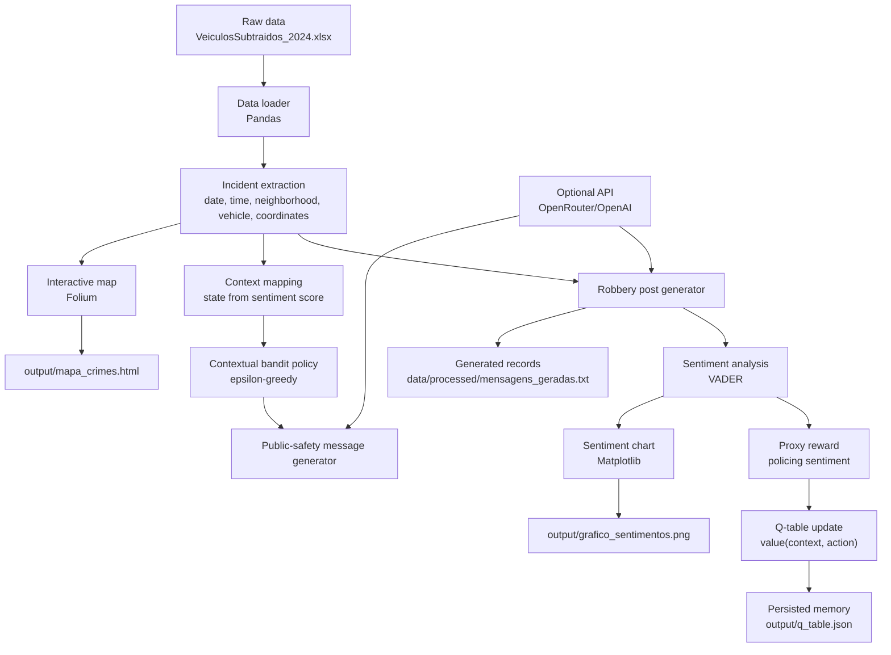

# Sentiment Analysis App

This project is derived from my MBA project. It processes vehicle-theft incident records, generates incident and public-safety posts, analyzes their sentiment, selects among message strategies using a simple contextual-bandit approach, and creates a map and sentiment chart.

> **Methodological note:** the current implementation is an incremental contextual-bandit/action-value estimator. It does not implement conventional Q-learning because it does not model a next state or bootstrap future action values. The sentiment of the generated message is used as a **proxy reward**; it is not an observed real-world outcome and does not establish that a message improves public safety.

## Architecture



The pipeline reads incident data from the spreadsheet, creates social-media posts for the reported event and for the public-safety follow-up, scores each message with VADER, and updates a small action-value table that selects the next message strategy. The generated artifacts are a map, a sentiment chart, and the serialized Q-table used for reuse across runs.

## Requirements

- Python 3.10 or newer (the Docker image uses Python 3.12).
- Dependencies listed in `requirements.txt`.
- An `OPENROUTER_API_KEY` (or `OPENAI_API_KEY`) environment variable to request generated messages from the configured OpenRouter model. Without a key, the application uses local fallback messages.

Install dependencies:

```bash
python -m pip install -r requirements.txt
```

The script downloads the NLTK VADER lexicon if it is not already available.

## Input data

Place `VeiculosSubtraidos_2024.xlsx` in `data/raw/`. The script reads the `AMOSTRAGEM` worksheet and expects fields such as `BAIRRO`, `DATA_OCORRENCIA_BO`, `HORA_OCORRENCIA`, `DESCR_TIPO_VEICULO`, `LATITUDE`, and `LONGITUDE`. The spreadsheet included in this repository is copied into the Docker image.

## Decision method

The incident-post sentiment score is discretized into one of three contexts. An epsilon-greedy policy selects one of three message prompts. After generating the selected message, VADER analyzes its sentiment and the corresponding action value is updated using an incremental estimate:

```text
value(context, action) <- value(context, action)
    + alpha * (proxy_reward - value(context, action))
```

This is a contextual-bandit-style update, not temporal-difference Q-learning. The current application does not model transitions to a next state, delayed rewards, or real-world effects of the messages. In fallback mode, the same local response is used for all actions, so the action choice cannot meaningfully be distinguished by the proxy reward. For meaningful experiments, configure the API and critically evaluate the reward design.

The action-value estimates are stored in `output/q_table.json` to preserve compatibility with earlier versions of the project. Existing root-level `q_table.json` files are loaded as a legacy fallback.

## Run locally

From the project root:

```bash
python rl_sentiment_app.py
```

The API key is optional. Set it in your shell before running if you want to use OpenRouter.

## Docker

Build the image from the repository root:

```bash
docker build -t sentiment-analysis .
```

Run without an API key (local fallback messages):

```bash
docker run --rm \
  -v "${PWD}/output:/app/output" \
  -v "${PWD}/data/processed:/app/data/processed" \
  sentiment-analysis
```

Run with OpenRouter (PowerShell):

```powershell
docker run --rm `
  -e OPENROUTER_API_KEY `
  -v "${PWD}/output:/app/output" `
  -v "${PWD}/data/processed:/app/data/processed" `
  sentiment-analysis
```

Run with OpenRouter (Bash):

```bash
docker run --rm \
  -e OPENROUTER_API_KEY \
  -v "${PWD}/output:/app/output" \
  -v "${PWD}/data/processed:/app/data/processed" \
  sentiment-analysis
```

The Docker image runs in headless mode, so it saves the chart without trying to open a browser inside the container. Mounting `output/` and `data/processed/` keeps generated files on the host after the container exits.

## Generated files

- `data/processed/mensagens_geradas.txt`: generated posts and sentiment results.
- `output/grafico_sentimentos.png`: sentiment chart.
- `output/mapa_crimes.html`: interactive incident map.
- `output/q_table.json`: persisted action-value estimates (legacy filename).

Generated outputs are excluded from Git. When the API is configured, the script waits three seconds between incidents to space out requests.
